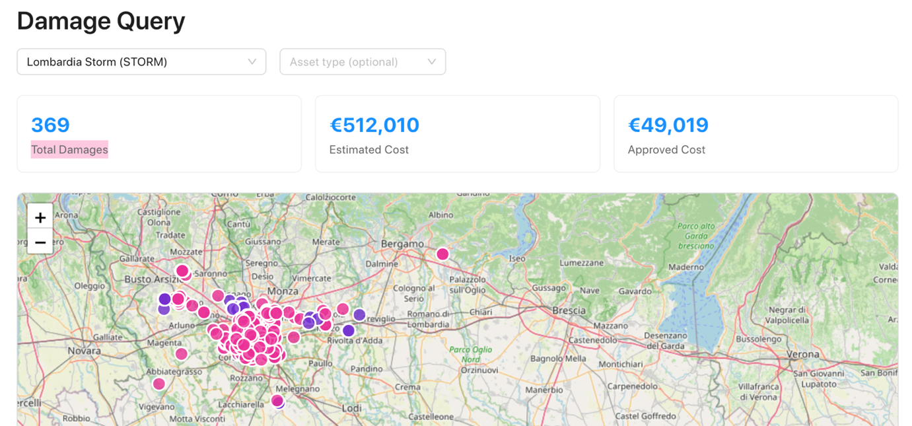

# Damage Query

Damage Query retrieves the damage information linked to a specific event.

## Selecting an event

Start by selecting an event from the list. The platform then builds a dashboard with an overview of the damage recorded for that event.

The dashboard shows three indicators:

- **Total Damages**
- **Estimated Costs**
- **Approved Costs**

They are calculated from the information entered in the data-entry and assessment sections.

<figure markdown="span">
  
  <figcaption>The Damage Query dashboard.</figcaption>
</figure>

## Filtering and consulting the records

Once an event is selected, you can narrow the results by asset type to focus on one category of assets and its damage records.

Below the map, a table lists the individual records and their details. Use it to examine the damage records stored in the database for the selected event and filters.
