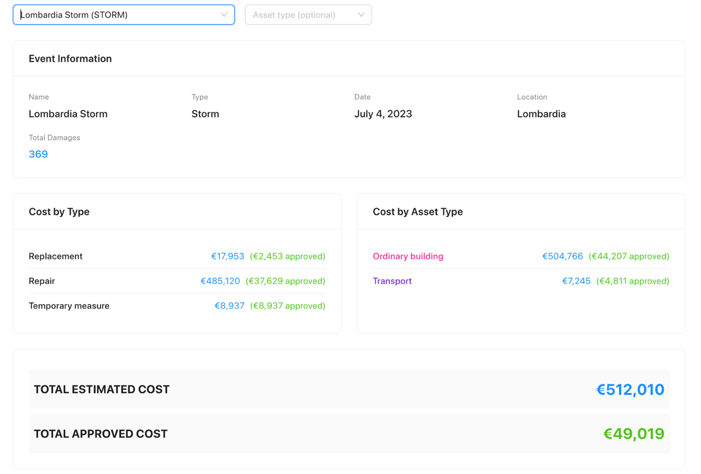

# Event Cost Analysis

Event Cost Analysis is a second view of the stored information that focuses on the economic consequences of events.

The filters are like those in [Damage Query](damage-query.md). The dashboard, however, processes the data differently and gives more weight to the analysis and distribution of costs. Use it to explore the economic information linked to an event and to examine the cost data that match your filters.

<figure markdown="span">
  
  <figcaption>The Event Cost Analysis dashboard.</figcaption>
</figure>
