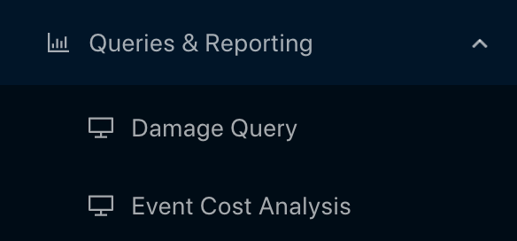

# Queries & Reporting

The Queries & Reporting section is where you retrieve, filter and analyse the information stored in the AHEAD database.

The other sections are mostly for entering and managing data. This one is for consulting and analysing data already in the platform. Its dashboards support the analysis of damage and of the related costs.

<figure markdown="span">
  { width="320" }
  <figcaption>The Queries & Reporting menu.</figcaption>
</figure>

The section has two tools:

- [Damage Query](damage-query.md): the damage recorded for an event, on a map and in a table.
- [Event Cost Analysis](event-cost-analysis.md): the economic consequences of an event and how its costs are distributed.
