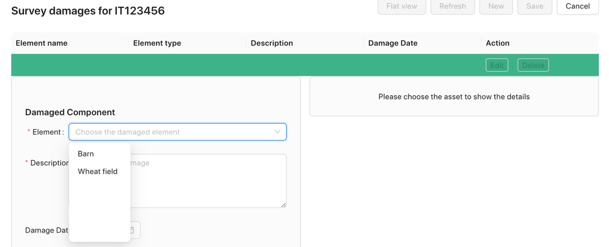
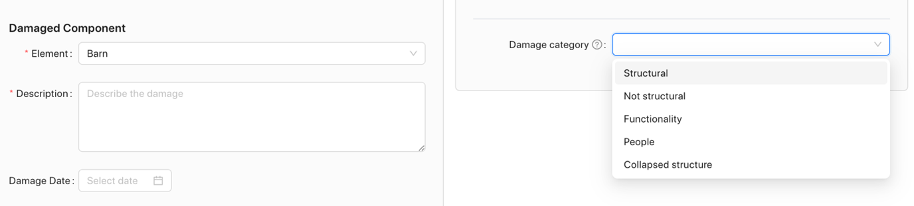
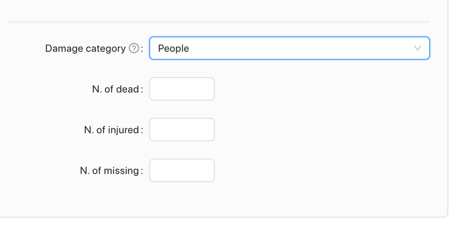
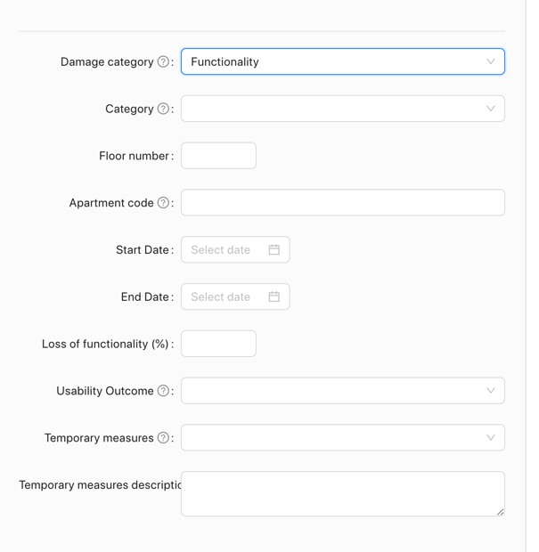
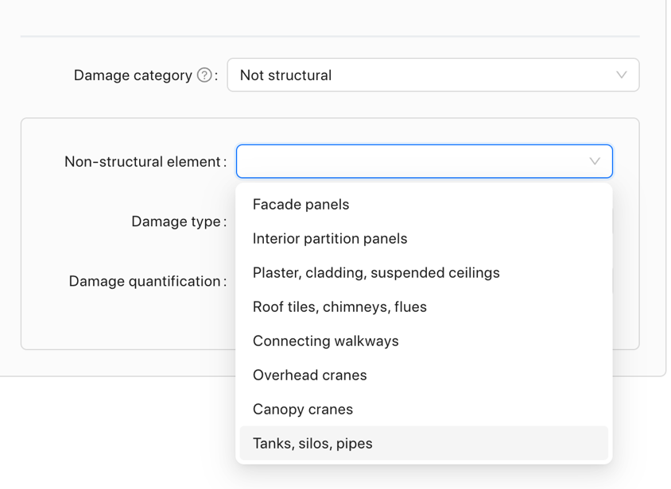
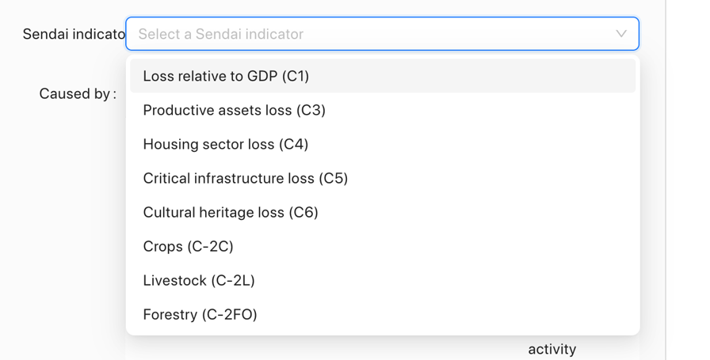
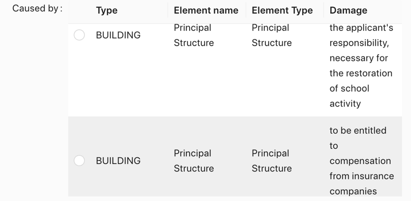

# Recording damage

The damage assessment itself takes place in the **Damages** page of a survey. Open it once the survey exists and its **Info** page is complete (see [Creating a survey](index.md#creating-a-survey)).

## Creating a damage record

1. Open the survey.
2. Go to the **Damages** page.
3. Click **New** to create a damage record.
4. Select the damaged element. The list contains the elements registered for this asset in [Elements & Production](../data-entry/baseline/elements-production.md).

    <figure markdown="span">
      
      <figcaption>Selecting the damaged element.</figcaption>
    </figure>

5. Select the damage type.
6. Fill in the fields that appear, with the characteristics of the damage and the assessment information.
7. Save the damage record.

Because the elements come from the asset's own inventory, every damage record is linked to the right asset and component.

## Classifying the damage

The first choice is the **type of damage** to the selected element. The platform then shows the fields and options needed to describe and classify that type of damage.

<figure markdown="span">
  
  <figcaption>Choosing the damage category.</figcaption>
</figure>

The form is dynamic. The fields on the right-hand side depend on the element and on the damage category selected, so different elements and categories ask for different assessment information. Review these fields carefully and fill in those that apply to the damage you are recording.

For example, the **People**, **Functionality** and **Not structural** categories show these fields:

<figure markdown="span">
  { width="380" }
  <figcaption>People: number of dead, injured and missing.</figcaption>
</figure>

<figure markdown="span">
  { width="330" }
  <figcaption>Functionality.</figcaption>
</figure>

<figure markdown="span">
  { width="450" }
  <figcaption>Not structural: choosing the non-structural element.</figcaption>
</figure>

### More than one type of damage to the same element

One element can suffer more than one type of damage. A barn, for example, may have both structural and functional damage.

In that case, create a separate damage record for each type, all pointing to the same element. Each record then has its own classification and assessment information. This keeps each damage mechanism, and its consequences, documented on its own.

## Sendai indicators

You can link each damage record to an indicator of the Sendai Framework for Disaster Risk Reduction. Where one applies, select it in the **Sendai indicator** field when you fill in the record.

<figure markdown="span">
  { width="450" }
  <figcaption>Selecting a Sendai indicator.</figcaption>
</figure>

## Damage causality

You can also record that one damage caused another. For example, primary damage to one component may lead to secondary damage to another component.

In the **Caused by** table, tick the damage record that caused the one you are entering. Damage records are then linked to each other instead of being treated as unrelated.

<figure markdown="span">
  { width="450" }
  <figcaption>Recording which damage caused this one.</figcaption>
</figure>
