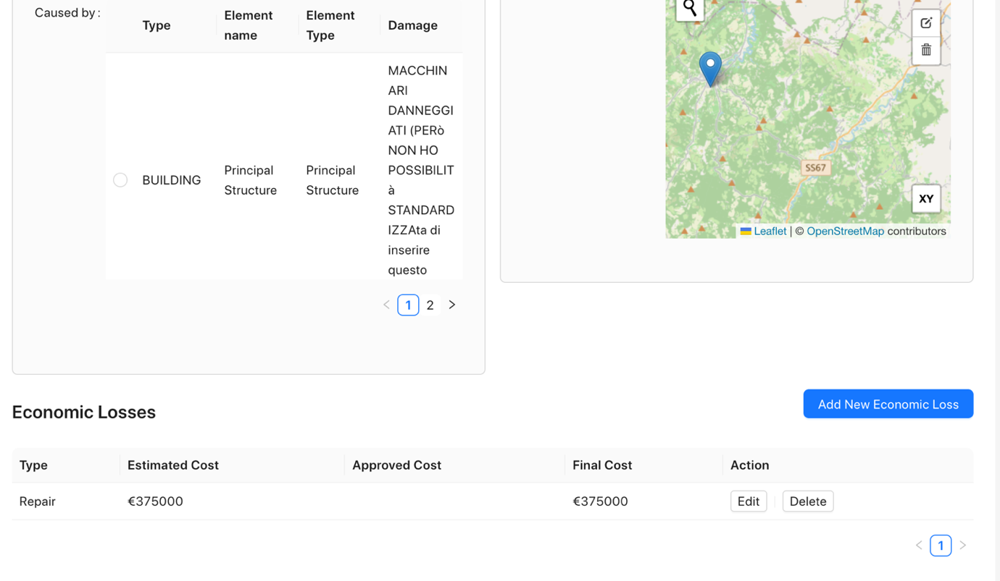
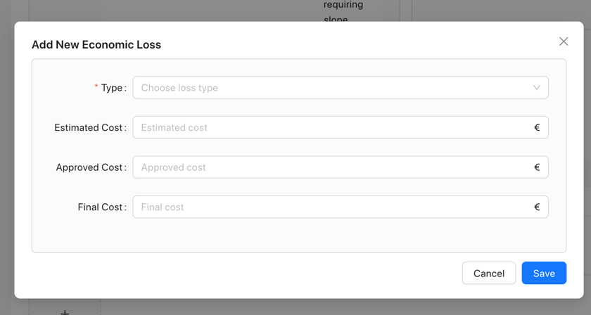

# Economic losses

Besides physical damage, a survey can record the **economic losses** linked to the event and the affected asset.

<figure markdown="span">
  
  <figcaption>Economic losses recorded in a survey.</figcaption>
</figure>

To add one, click **Add New Economic Loss** and fill in the window that opens.

<figure markdown="span">
  { width="450" }
  <figcaption>The Add New Economic Loss window.</figcaption>
</figure>

Fill in the fields with the information available from the survey, or from official documents received later.
