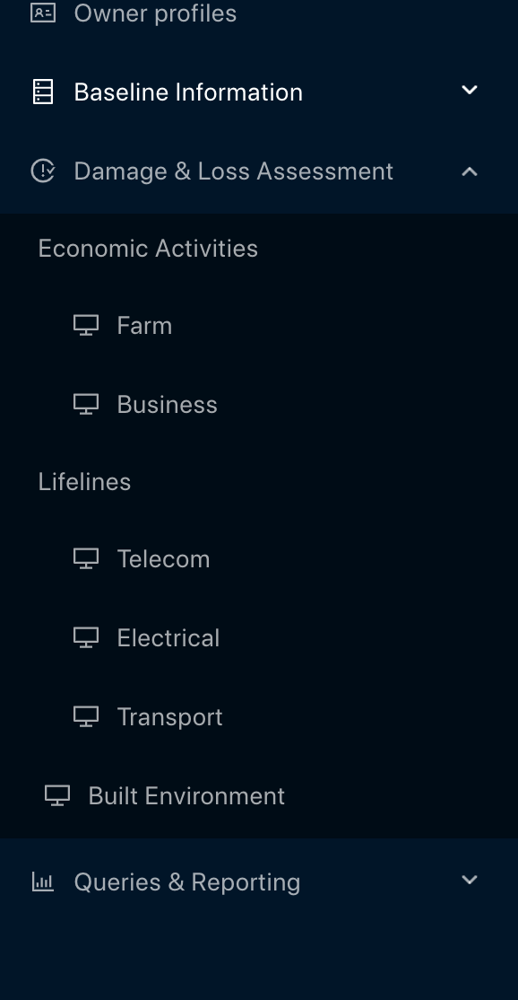
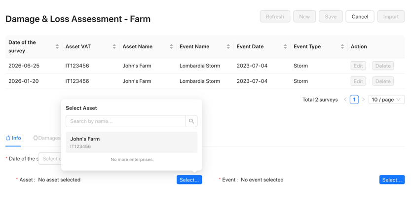
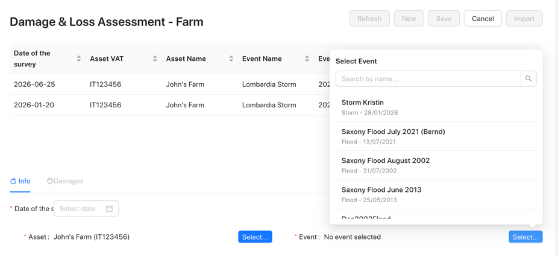

# Damage & Loss Assessment

The Damage & Loss Assessment section is where you record and classify the damage and losses suffered by the assets registered in [Baseline Information](../data-entry/baseline/index.md).

It is laid out like Baseline Information. A sidebar menu, organised by sector, leads to the sub-sections.

<figure markdown="span">
  { width="260" }
  <figcaption>The Damage & Loss Assessment menu.</figcaption>
</figure>

## Surveys

All assessment work is organised in **surveys**. A survey brings together, for one assessment:

- the **event** that caused the damage,
- the **asset** being assessed,
- the **owner** or managing organisation of the asset,
- the **date** of the survey.

The event, asset and owner are taken from records that already exist. Only the survey date is entered when the survey is created.

The upper part of the page lists the surveys already registered. Select a survey to view its details or to edit it.

## Creating a survey

1. Open the sector's page in Damage & Loss Assessment and click **New**.
2. Select the asset (in this example, a farm) that you registered in Baseline Information.

    <figure markdown="span">
      
      <figcaption>Selecting the asset to assess.</figcaption>
    </figure>

3. Select the event from those already registered in the database.

    <figure markdown="span">
      
      <figcaption>Selecting the event.</figcaption>
    </figure>

4. Enter the survey date.
5. Check the information and click **Save**.

The new survey record is now created. Next, [record the damage](damage-records.md).
