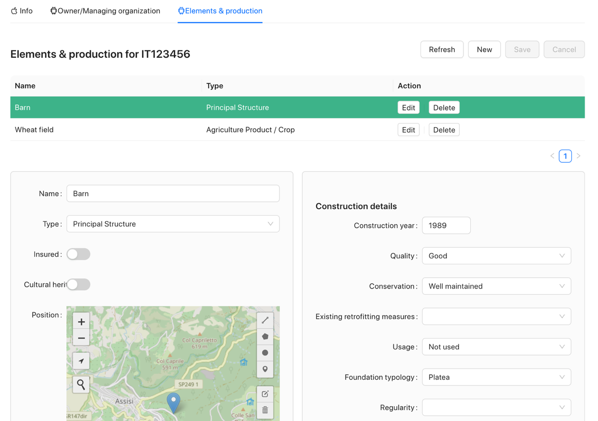
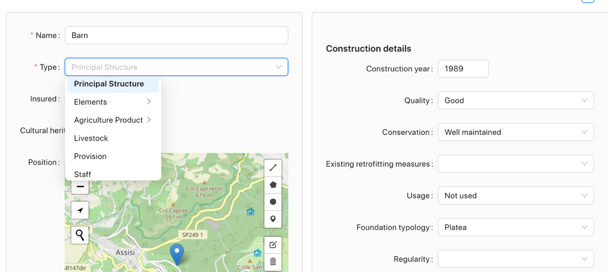

# Elements & Production

The Elements & Production page is where you register the individual components, structures or production lines of an asset.

!!! warning "Catalogue every damaged component"
    The elements registered here form the reference list used in [Damage & Loss Assessment](../../assessment/index.md). A component missing from this list cannot be recorded as damaged. Make sure every damaged component of the surveyed asset is catalogued.

<figure markdown="span">
  
  <figcaption>The Elements & Production page.</figcaption>
</figure>

The page lists the elements already registered for the asset. Each row has actions to edit or delete the element, depending on your permissions.

## Creating an element

1. Open the **Elements & Production** page and click **New**.
2. Select the element category from the **Type** list.

    <figure markdown="span">
      
      <figcaption>Choosing the element type.</figcaption>
    </figure>

3. Fill in the fields that appear.
4. Enter the characteristics needed to classify the exposure of the element.
5. Where available, draw the position of the element on the map with the drawing tools.
6. Check the information.
7. Click **Save**.

The form changes with the element type. Each category asks for the information needed to describe its own exposure characteristics.
