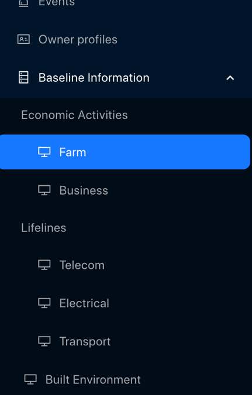

# Baseline Information

The Baseline Information section is where you register and manage the information that describes the surveyed assets.

This information records the **exposure characteristics** of each asset: its physical, functional and operational characteristics before any damage assessment takes place.

[Damage & Loss Assessment](../../assessment/index.md) builds on it later. The assets and elements registered here are the ones you select when you record which parts of an asset an event damaged.

## Sectors

The platform groups assets by sector. The sectors currently available are:

- **Economic Activities**
    - Farms
    - Businesses
- **Lifelines**
    - Telecommunication
    - Electrical infrastructure
    - Transport infrastructure
- **Built Environment**

<figure markdown="span">
  { width="280" }
  <figcaption>The sectors in the Baseline Information menu.</figcaption>
</figure>

!!! note "Sectors under development"
    Water systems, defence infrastructure and disaster waste are under development. The list of sectors may change as the platform develops further.

## Surveying the same asset more than once

The same asset can be surveyed more than once. This lets you follow damage to one asset over time, for example when it is hit by different events or assessed repeatedly.

You therefore do not need to create a new asset record for each survey. Retrieve the existing asset and reuse its information.

## Working with assets

The next pages use a farm as the example:

1. [Registering a farm](register-farm.md): enter the general information and link the owner.
2. [Elements & Production](elements-production.md): catalogue the elements and production lines of the asset.
