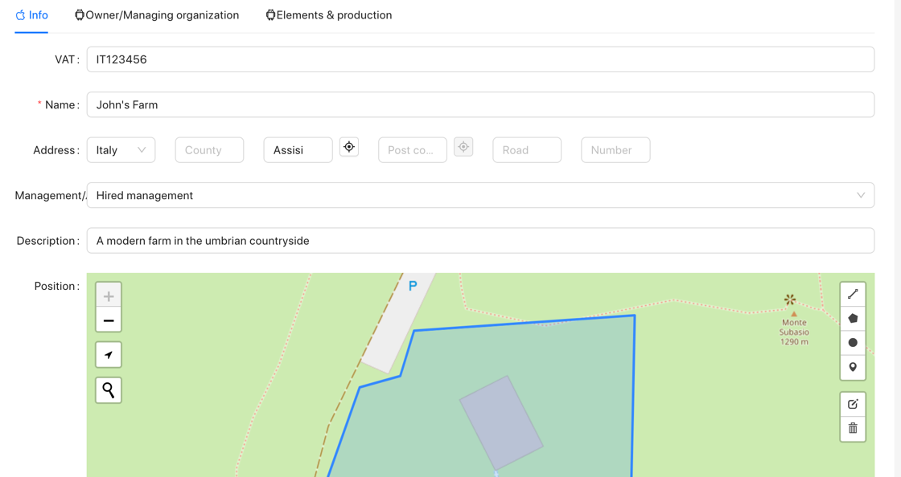

# Registering a farm

Farms belong to the **Economic Activities** sector. Open **Baseline Information → Economic Activities → Farm** in the sidebar to see the list of farms already in the database.

Check the list before you create a new farm. If the farm is already registered, reuse it instead of creating a duplicate (see [Surveying the same asset more than once](index.md#surveying-the-same-asset-more-than-once)).

To register a new farm, click **New**. Data entry is split across three pages, shown as tabs at the top of the form.

## Step 1 – Info

Fill in the **Info** page with the general information and characteristics of the farm.

<figure markdown="span">
  
  <figcaption>The Info page of a farm.</figcaption>
</figure>

## Step 2 – Owner/Managing Organisation

Open the **Owner/Managing Organisation** page. Link the farm to an owner or managing organisation that you registered earlier in [Owner Profiles](../owner-profiles.md). Selecting an existing profile connects the asset to its ownership or management information.

## Step 3 – Elements & Production

Open the **Elements & Production** page and catalogue the individual elements or production lines of the farm.

Do not skip this step. Only the elements registered here can be selected in Damage & Loss Assessment. The page is described in [Elements & Production](elements-production.md).
