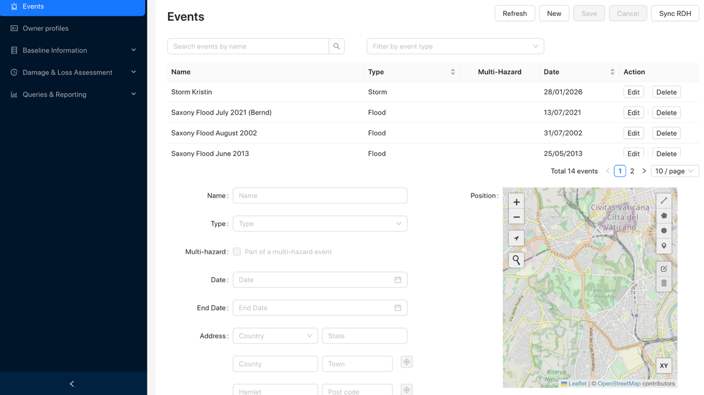
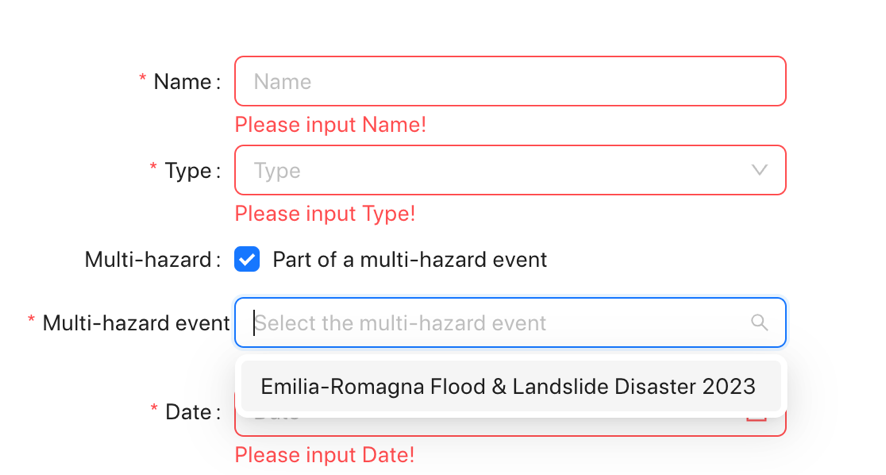
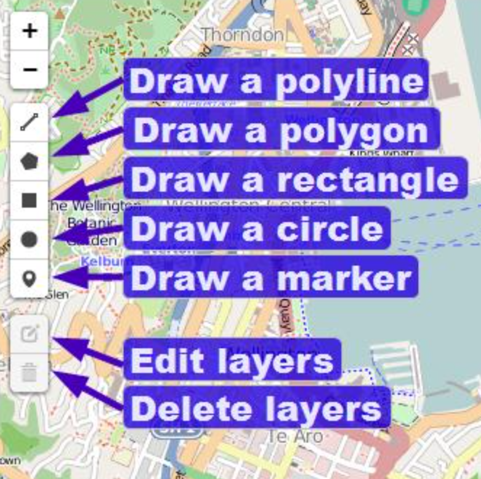

# Events

The Events section is where you create and manage the events that may cause damage and losses to the assets surveyed in AHEAD.

An event can be a storm, flood, tornado, hurricane, wildfire, earthquake, drought or landslide. The platform can also classify multi-hazard events.

<figure markdown="span">
  
  <figcaption>The Events page.</figcaption>
</figure>

The page has two areas:

- **The events list** at the top shows the events already registered in the database.
- **The event form** below it is where you enter a new event or change an existing one.

## The events list

You can find an event in two ways:

- type its name in the search field, or
- filter the list by event type: tornado, storm, hurricane, flood, wildfire, earthquake, drought, landslide or multi-hazard event.

The table lists the registered events and their main characteristics:

| Column | Content |
| :--- | :--- |
| **Name** | The name given to the event, for example *Storm Kristin*, *Saxony Flood July 2021 (Bernd)*, *Saxony Flood August 2002* or *Saxony Flood June 2013*. |
| **Type** | The event type. |
| **Multi-Hazard** | Whether the event is part of a multi-hazard occurrence. |
| **Date** | The recorded date of the event. |
| **Action** | Buttons to edit or delete the event. |

## Creating a new event

1. Click **New** in the upper-right corner of the Events page.
2. Enter the name of the event.
3. Select the event type from the drop-down menu. To register a multi-hazard event itself, choose **Multi-Hazard Event** as the type.
4. If the event is part of a multi-hazard occurrence that is already in the database, tick the multi-hazard option and select that occurrence from the list.

    <figure markdown="span">
      { width="450" }
      <figcaption>Linking an event to a registered multi-hazard event.</figcaption>
    </figure>

5. Enter the date of the event.
6. Define where the event happened, in one of two ways:
    - type the address in the address fields, or
    - draw the affected area on the interactive map.
7. Check that the information is complete and correct.
8. Click **Save** to register the event.

The drawing tools on the map let you mark the event area as a polyline, a polygon, a rectangle, a circle or a marker. You can also edit or delete what you have drawn.

<figure markdown="span">
  { width="300" }
  <figcaption>The map drawing tools.</figcaption>
</figure>

Once saved, the event appears in the events list. You will select it later, mainly when you create a survey in [Damage & Loss Assessment](../assessment/index.md).
