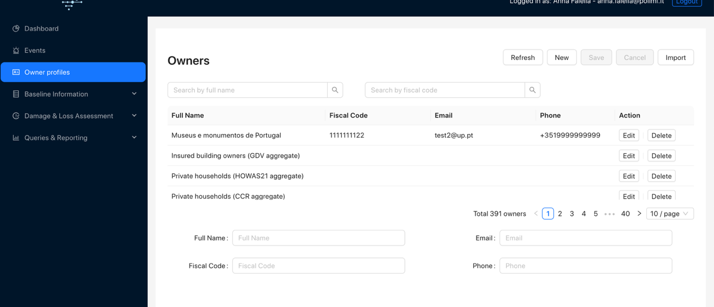

# Owner Profiles

The Owner Profiles section is where you create and manage information on the individuals or organisations that own or manage the surveyed assets.

An *owner* is not only a private property owner. It can also be an institution, a company or the organisation that manages the asset.

!!! warning "Register owners first"
    Register the owner before you create the asset in [Baseline Information](baseline/index.md). You can then link the right owner or managing organisation to each asset.

<figure markdown="span">
  
  <figcaption>The Owner Profiles page.</figcaption>
</figure>

The page has two areas:

- **The owner profiles list** shows the profiles already registered in the database.
- **The profile form** is where you create a new profile or change an existing one.

## Creating an owner profile

1. Fill in the fields:

    | Field | Content |
    | :--- | :--- |
    | **Full Name** | Name of the individual, institution or managing organisation. |
    | **Fiscal Code** | Tax identification or fiscal code of the owner or organisation. |
    | **Email** | Contact email address. |
    | **Phone** | Contact telephone number. |

2. Check that the details are correct and belong to the person or organisation linked to the asset.
3. Click **Save**.

The new profile then appears in the owner profiles list.

## Editing and reusing profiles

You can select an existing profile from the list and change it when needed. Saved profiles can be reused whenever you create or update an asset record, so the same owner does not have to be entered twice.
