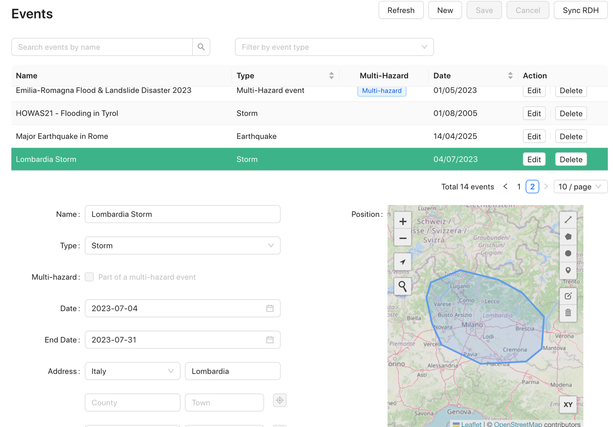
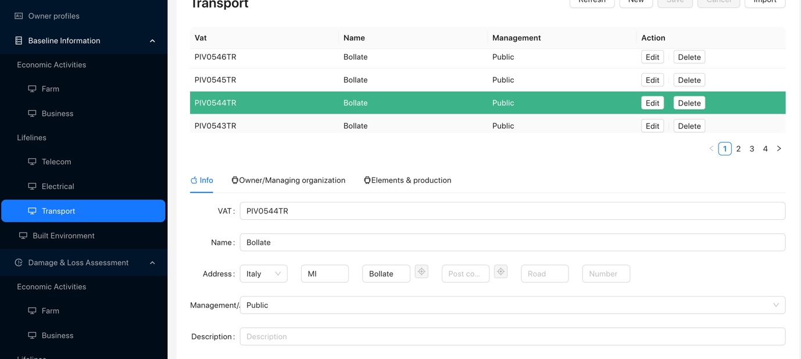
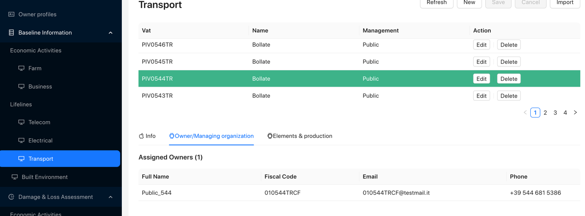
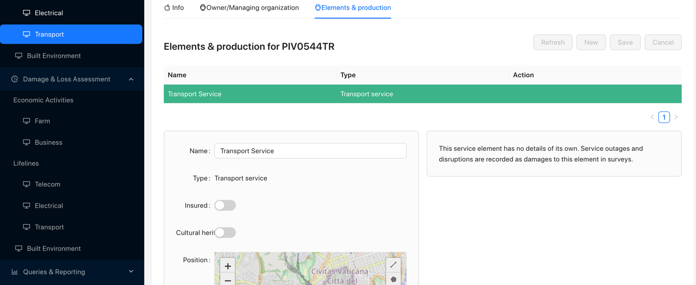
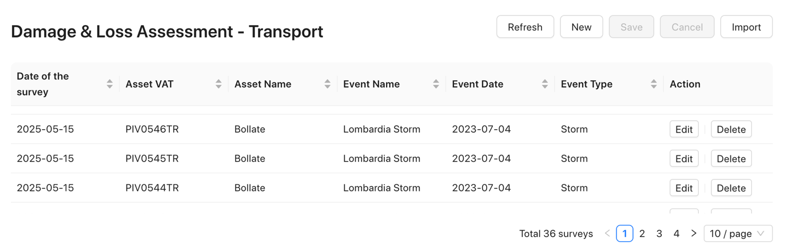
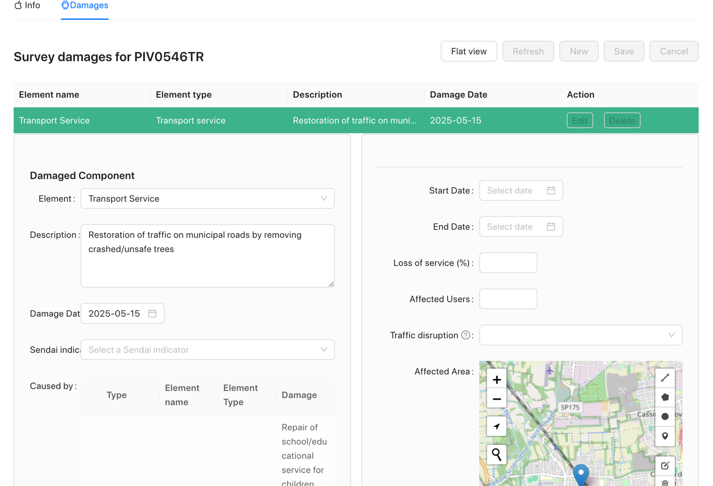

# Example: the Regione Lombardia testbed

The Regione Lombardia event was one of the first testbeds set up in AHEAD. It shows how information on a hazard event, the exposed assets and the resulting damage and losses can be recorded, organised and analysed in the AHEAD database.

<figure markdown="span">
  
  <figcaption>The Lombardia event as recorded in the AHEAD database.</figcaption>
</figure>

!!! info "Owner profiles are fictitious"
    The owner profiles in the testbed contain fictitious information. Owner details are mandatory when registering an asset, so made-up data were used instead of real personal or organisational information. These profiles are for demonstration and testing only and do not match real owners or managing organisations.

The screenshots below follow the records for the **transport** sector, from the description of the exposed assets to the recording of damage and losses.

## Baseline Information

<figure markdown="span">
  
  <figcaption>Transport assets and their general information.</figcaption>
</figure>

<figure markdown="span">
  
  <figcaption>The owner assigned to a transport asset.</figcaption>
</figure>

<figure markdown="span">
  
  <figcaption>The elements of a transport asset.</figcaption>
</figure>

## Damage & Loss Assessment

<figure markdown="span">
  
  <figcaption>Surveys of transport assets for the Lombardia event.</figcaption>
</figure>

<figure markdown="span">
  
  <figcaption>A damage record for a transport asset.</figcaption>
</figure>
