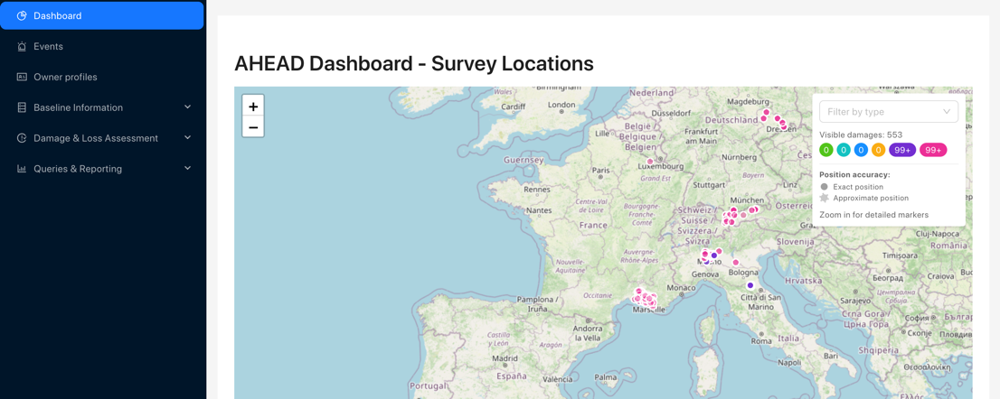
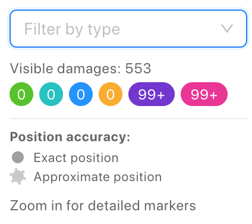
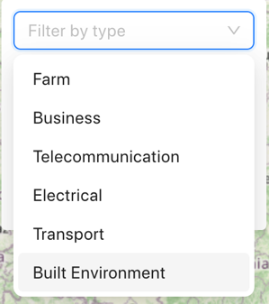
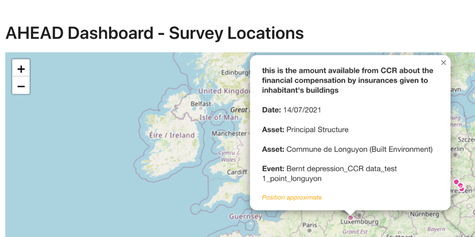

# Dashboard

The Dashboard gives a first overview of the data collected through AHEAD. At present it shows the information from the testbeds run during the project.

<figure markdown="span">
  
  <figcaption>The Dashboard.</figcaption>
</figure>

Its main component is an interactive map of the reported damage locations. Use it to see where impacts were recorded, find areas with reported damage and filter the records by category.

## Navigating the map

| Tool | What it does |
| :--- | :--- |
| **Zoom in (+)** | Shows a smaller area in more detail. |
| **Zoom out (−)** | Shows a wider area. |
| **Click and drag** | Moves the map. |
| **Damage markers** | Coloured circles mark the locations linked to recorded damage. |

## The information panel

An information panel sits in the upper-right corner of the map. It contains filters and indicators that help you read the map.

<figure markdown="span">
  { width="300" }
  <figcaption>The information panel.</figcaption>
</figure>

**Filter by type**
:   Shows only the damage records from one sector of affected assets: Farm, Business, Telecommunication, Electrical, Transport or Built Environment.

    <figure markdown="span">
      { width="220" }
      <figcaption>The Filter by type menu.</figcaption>
    </figure>

**Visible damages**
:   The number of damage records currently visible on the map.

**Coloured counters**
:   The number of records for each case study, that is, each testbed run during the project. Each colour stands for one case study.

**Position accuracy**
:   How precisely each damage location is known:

    - *Exact position*: the location was identified precisely.
    - *Approximate position*: the location is an estimate and may not match an exact point.

**Zoom in for detailed markers**
:   More markers and more detailed information appear as you zoom in.

<figure markdown="span">
  
  <figcaption>Details of a damage record after zooming in.</figcaption>
</figure>

Combining the map tools with the filters gives a detailed picture of where impacts occurred and what AHEAD has recorded about them.
