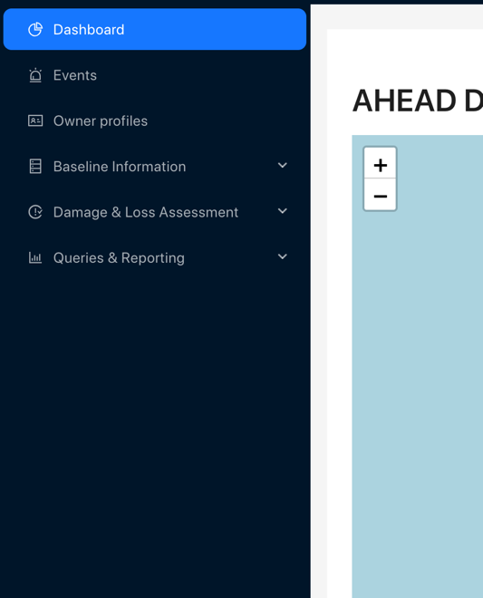

# Platform layout

The sidebar on the left of the interface is the main navigation menu. It gives access to every section of the platform.

<figure markdown="span">
  { width="300" }
  <figcaption>The sidebar.</figcaption>
</figure>

The sidebar contains the following sections:

**Dashboard**
:   An overview of the data collected through AHEAD, with the geographical distribution of reported damage locations. See [Dashboard](dashboard.md).

**Events**
:   Manage the events linked to the recorded damage, including event type, dates and location. See [Events](../data-entry/events.md).

**Owner Profiles**
:   Create and manage profiles of the owners or managing organisations of the surveyed assets. An owner can be an individual, an institution or an organisation responsible for an asset. See [Owner Profiles](../data-entry/owner-profiles.md).

**Baseline Information**
:   Enter and manage the information that describes the surveyed assets. This is their exposure characteristics, and it is the reference dataset for later damage and loss assessments. See [Baseline Information](../data-entry/baseline/index.md).

**Damage & Loss Assessment**
:   Record and classify the damage and losses linked to previously registered assets and events. See [Damage & Loss Assessment](../assessment/index.md).

**Queries & Reporting**
:   Retrieve, filter and analyse the information in the AHEAD database through dedicated queries and reporting dashboards. See [Queries & Reporting](../analysis/index.md).
